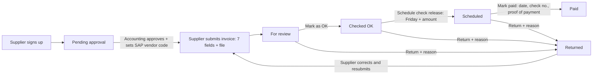

# Flexo Supplier Invoice Portal

Suppliers sign up, Flexo Accounting approves them, and then they submit invoices online.
Each submission is 7 required fields plus the invoice file. Accounting checks each invoice,
schedules its check release for a Friday, and marks it paid with a proof of payment. The
supplier sees when they will be paid and how much, and can open the proof once it is paid.

| Piece | Where it runs |
|---|---|
| Web app (`public/`) | GitHub Pages (static hosting, deployed by GitHub Actions) |
| Accounts, database, file storage | Supabase (Auth + Postgres + Storage) |

`original/Flexo_Supplier_Invoice_Portal.html` is the first claude.ai prototype, kept for reference.

---

## How it works



### Accounting steps
1. **For review → Mark as OK.** Check the typed values against the attached invoice and SAP.
2. **Checked OK → Schedule check release.** You can tick several invoices and click
   **Schedule selected** for a Friday, which releases the full total for each. Or you can open one
   invoice and set the **amount to be released** and a **note to the supplier**, for example
   *less 1% EWT*. The release date can only be a Friday. The amount can't be more than the invoice total.
   You can change or remove a schedule until the invoice is paid.
3. **Scheduled → Mark as paid.** Enter the payment date and check / reference no., and attach the
   **proof of payment** (PDF, JPG or PNG). Once paid, the invoice can't be changed any more.

The **Scheduled for release** list shows the total per Friday, which you can use for the check run.
Use **Export CSV** to download the list.

### What the supplier sees
- **My invoices** shows each invoice's status.
- Once scheduled, it shows the **check release date and amount**, with any note. A card at the top
  totals each upcoming Friday.
- Once paid, it shows the payment date and reference, and a **View proof of payment** button.

### Invoice fields (all required)
1. Invoice number
2. Invoice date
3. PO number
4. VAT-exclusive amount
5. Total amount (the VAT is calculated and shown as Total − VAT-exclusive)
6. DR (delivery receipt) number
7. DR date

The invoice file (PDF, JPG or PNG, up to 10 MB) is also required.

The form also rejects these entries: a future date, a total lower than the VAT-exclusive
amount, and an invoice number the same supplier has already submitted (unless the earlier
one was returned).

There is **no automatic matching against SAP**. Staff check each invoice against the
attached file and SAP before approving. To help them, the invoice detail shows a warning
when the VAT isn't about 12%, when the same DR number appears on another invoice, or when
the invoice number was used before.

### Roles
| Role | Can do |
|---|---|
| Supplier (pending) | Sign in and see "awaiting approval". Cannot submit |
| Supplier (approved) | Submit invoices, and see **only their own** invoices and files |
| Staff | See all invoices; mark OK, return, schedule check release, mark paid with proof; approve or reject supplier accounts and set their SAP vendor code; export CSV |
| Admin | Everything staff can do, and also make other accounts staff or admin |

These rules are enforced **by the database** (Supabase row-level security in
`supabase/schema.sql`), not just hidden in the screen. A supplier cannot read another
supplier's invoices or files, approve their own invoice, change an amount after
submitting, or make themselves staff. Every status change is written to a history log
that nobody can edit.

---

## Setup

### 1. Supabase database
1. In your Supabase project, open **SQL Editor**. Paste the whole of `supabase/schema.sql` and click **Run**.
   Run it again after every update to this file. It is safe to re-run and keeps your data.
   - If you used the earlier pilot version, this also locks its old open table (`docs`).
     Nothing is deleted. You can remove that table later with `drop table public.docs;`.
2. Go to **Authentication → Sign In / Providers → Email**:
   - Keep **Email** enabled.
   - **Turn OFF "Confirm email"**. Flexo's approval step already confirms who each supplier is.
3. Go to **Authentication → URL Configuration**:
   - Set **Site URL** to `https://fmcai70.github.io/FlexoSupplier/`.
   - Under **Redirect URLs**, add `https://fmcai70.github.io/FlexoSupplier/**`. The `**` covers both the
     supplier page and the staff page, so password-reset links return to the right one.

### Two sign-in pages
| Who | Link | What's there |
|---|---|---|
| Suppliers | `https://fmcai70.github.io/FlexoSupplier/` | Sign in, supplier **Sign up**, Forgot password |
| Flexo staff | `https://fmcai70.github.io/FlexoSupplier/staff/` | Sign in, **Request access** (only `@flexo.com.ph` emails), Forgot password |

- Staff or admin who open the supplier page are sent to the staff page automatically.
- A supplier who signs in on the staff page is told to use the supplier portal.
- Asking for staff access grants nothing by itself. The database only records "staff request" for
  `@flexo.com.ph` emails, and an admin must still approve it.
- Share the staff link only inside Flexo. Search engines are asked not to list it.

### Staff sign-in protection
Staff powers need a **strong login**, and the database enforces this (`strong_login()` in
`supabase/schema.sql`). A staff or admin account signed in with only a password can't see or change
anything.

| How staff sign in | What they need |
|---|---|
| Email + password | Plus a **6-digit code** from Microsoft or Google Authenticator. The portal walks them through setup (QR code) the first time |
| *Sign in with Microsoft 365* | *Parked: not set up. The button stays hidden until the optional steps below are done* |

Only **@flexo.com.ph** accounts can be staff or admin. Staff sign-up only accepts Flexo emails, and the
database refuses to give the staff or admin role to any other email, even from the SQL Editor.

⚠️ Microsoft sign-in counts as strong only if **Microsoft 365 itself requires two-step sign-in** (MFA,
Security defaults or Conditional Access). Ask IT to confirm this is on for all staff.

**Lost phone / new phone:** an admin runs this in the Supabase SQL Editor, and the person sets up a
new code at their next sign-in:
```sql
delete from auth.mfa_factors where user_id = (select id from auth.users where email = 'name@flexo.com.ph');
```

**Optional, parked for now: set up "Sign in with Microsoft 365" (IT, one time).**
1. **Azure portal → Microsoft Entra ID → App registrations → New registration**
   - Name: `Flexo Supplier Portal – staff sign-in`
   - Accounts: **this organizational directory only** (single tenant)
   - Redirect URI: **Web**, `https://<project-ref>.supabase.co/auth/v1/callback`
2. In the new app, go to **Certificates & secrets → New client secret** and copy the secret's **Value**.
   Also note the **Application (client) ID** and **Directory (tenant) ID** on the Overview page.
3. Recommended: under **Token configuration → Add optional claim → ID**, tick `email` and `xms_edov`.
4. **Supabase → Authentication → Sign In / Providers → Azure**: enable it. Paste the client ID and the
   secret value, and set **Azure Tenant URL** to `https://login.microsoftonline.com/<tenant-id>`. This
   allows only Flexo accounts. Save.
5. **GitHub → Settings → Secrets and variables → Actions → Variables**: add `MS_LOGIN` = `true`, then
   run the **Deploy portal to GitHub Pages** workflow. The Microsoft button appears on the staff page.
6. The first time someone signs in with Microsoft, a **staff request** is created. Approve it under
   **Accounts**. If they already had a password account, the Microsoft sign-in may show up as a
   separate account to approve.

### 2. Create the first admin
1. Open the **staff page** and choose **Request access** with your own Flexo email. You can also
   use any account that already exists.
2. In the Supabase **SQL Editor**, run this with your own email:
   ```sql
   update public.profiles set role = 'admin', status = 'approved' where email = 'your.name@flexo.com.ph';
   ```
3. Sign out and sign in again on the staff page. Set up the 6-digit code when asked (or use Microsoft
   sign-in), and you'll see the **Invoices** and **Accounts** tabs.

Other staff choose **Request access** on the staff page. An admin approves them under **Accounts**; the
role is already set to `staff` for these requests.

### 3. Approve suppliers
Go to **Accounts → Pending approval**. Check the company name, TIN and contact, then
type the supplier's **SAP vendor code** (CardCode) and click **Approve**. To refuse an account,
click **Reject** and give a reason, which the applicant will see.

### 4. GitHub Pages
This is already set up: the `SUPABASE_URL` and `SUPABASE_ANON_KEY` repository variables, Pages
source set to GitHub Actions, and the `github-pages` environment allowing `main`. Every push to
`main` redeploys the site.

### ✉️ Email notifications (Microsoft 365 via Graph)
| Email | Sent to |
|---|---|
| New supplier sign-up (approval needed) | AP mailbox |
| New invoice submitted | AP mailbox |
| Account approved / rejected | Supplier |
| Invoice returned (with reason) | Supplier |
| Payment scheduled / schedule changed (Friday + amount) | Supplier |
| Invoice paid (date, check no., proof in portal) | Supplier |
| Password reset | Supplier (from "Forgot password") |

Each event is put in an email queue in the database (`notifications`). The **notify** function sends
the queue through your Microsoft Graph app, and failed emails are retried. Password-reset emails go
through the **send-auth-email** function, using Supabase's "Send Email" hook.

**One-time setup.** Use the same Graph app as your other Supabase project. It needs the **Mail.Send**
*application* permission and must be allowed to send as `MAIL_SENDER`.

1. Run the latest `supabase/schema.sql` in the SQL Editor.
2. **Edge Functions → Secrets**: add the following. Copy the Graph values from your other project and type
   them yourself. Never paste them into chat or into code.
   | Name | Value |
   |---|---|
   | `MS_TENANT_ID` | Microsoft 365 tenant ID |
   | `MS_CLIENT_ID` | Graph app (client) ID |
   | `MS_CLIENT_SECRET` | Graph app client secret |
   | `MAIL_SENDER` | Mailbox the emails come from, e.g. `ap-portal@flexo.com.ph` |
   | `AP_EMAIL` | Accounting's shared mailbox |
   | `PORTAL_URL` | `https://fmcai70.github.io/FlexoSupplier/` |
3. **Edge Functions → Deploy a new function → Via Editor**. Do this twice:
   - Name `notify`: paste `supabase/functions/notify/index.ts` and deploy.
   - Name `send-auth-email`: paste `supabase/functions/send-auth-email/index.ts` and deploy.
     Then open its **Details** and turn **OFF "Verify JWT"** (Enforce JWT verification).
4. **Authentication → Auth Hooks → Add hook → Send Email hook**: choose **HTTPS**. Set the URL to
   `https://<project-ref>.supabase.co/functions/v1/send-auth-email`, click **Generate secret**, and save.
   Copy that secret (it starts with `v1,whsec_`) into a new Edge Function secret named
   `SEND_EMAIL_HOOK_SECRET`.
5. Test it: use **Forgot password** on the portal with your own email, and approve a test supplier.
   If an email doesn't arrive, look in **Edge Functions → notify / send-auth-email → Logs**. In the
   SQL Editor, `select kind, attempts, last_error from notifications order by id desc limit 20;` shows
   the error for each queued email.

With CLI instead of the dashboard: `supabase functions deploy notify` and
`supabase functions deploy send-auth-email --no-verify-jwt`.

### Local testing
```bash
cp public/config.example.js public/config.js   # fill in URL + anon key
npx http-server public -p 8080                 # open http://localhost:8080
```

---

## Files
| Path | What it is |
|---|---|
| `public/index.html`, `public/app.js`, `public/styles.css` | The portal (supplier page) |
| `public/staff/index.html` | Staff sign-in page (same app in staff mode) |
| `supabase/schema.sql` | Tables, security rules, file storage, history log, email queue |
| `supabase/functions/notify` | Sends queued emails through Microsoft Graph |
| `supabase/functions/send-auth-email` | Password-reset emails through Microsoft Graph (Send Email hook) |
| `.github/workflows/deploy-pages.yml` | Publishes `public/` to GitHub Pages |
| `sap/*.sql` | SAP B1 export queries for POs and GRPOs. **Not used** by this version, which has no automatic matching. Kept for later |
