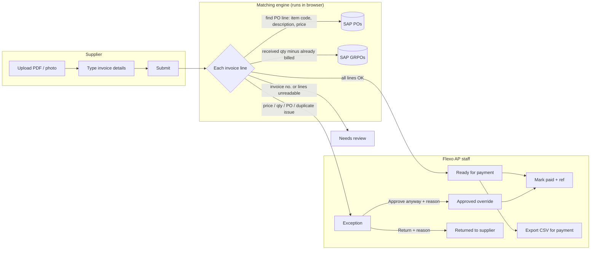

# Flexo Supplier Invoice Portal

Suppliers upload their invoice file and type in its details. The portal checks every line
against SAP Business One data: the **PO price** and the **GRPO received quantity**
(a three-way match). An invoice that matches goes straight to the *Ready for payment*
queue. Anything else is held as an exception for Accounts Payable.

This repo hosts the portal outside claude.ai for a **temporary pilot**:

| Piece | Where it runs |
|---|---|
| Web app (`public/`) | GitHub Pages (static hosting, deployed by GitHub Actions) |
| Database, realtime updates, file storage | Supabase (Postgres + Realtime + Storage) |

`original/Flexo_Supplier_Invoice_Portal.html` is the untouched claude.ai artifact.
`public/index.html` is the same app with only a few edits: it loads three scripts and
links to the original file in a different way. `public/claude-shim.js` connects the
app to Supabase so the rest of the code stays the same.

---

## How the app works



### Roles and sign-in
- **Supplier**: chooses their company and enters the 6-digit access code that Flexo gave them.
  They see two tabs: *Submit invoice* and *My submissions* (status: received, paid or returned).
- **Flexo staff**: enters their name and the shared staff PIN (default `2026`, change it under *Rules*).
  Staff see four tabs: *Payment queue*, *SAP data*, *Supplier access* and *Rules*.

### Data the app keeps (Supabase table `docs`, grouped by `collection`)
| Collection | One row per | Filled by |
|---|---|---|
| `sap_po` | SAP purchase order + lines (item, description, qty, UoM, **price**) | IT imports a CSV exported from OPOR/POR1 |
| `sap_grpo` | Goods receipt PO + lines (base PO, base line, **received qty**) | IT imports a CSV exported from OPDN/PDN1 |
| `vendors` | Supplier code, name, access code, enabled flag | Staff → *Supplier access* (suppliers appear automatically from POs) |
| `invoices` | Submitted invoice: extracted fields, match result, status, history log | Supplier submit + staff actions |
| `invoice_files` | Small JPEG previews of each invoice page | Supplier submit |
| `settings` | `app` (tolerances, PIN) and `sap_import` (last import info) | Staff → *Rules*, SAP import |

The original uploaded files go to the private Storage bucket `invoice-files`.

### Matching rules (`runMatch` in `public/index.html`)
For each invoice line the app finds the best PO line from that supplier's POs. It scores
each PO line on: same item code (+100), similar description (up to +60), and unit price
within tolerance (+25). Then it checks:
1. **PO found**, and the PO belongs to the same supplier.
2. **Price**: the invoice unit price is within ±`priceTolPct`% of the PO price (default 0.5%).
3. **Quantity**: billed qty ≤ (qty received on GRPOs − qty already billed on earlier cleared invoices), plus `qtyTolPct`% (default 0%).
4. **Duplicate**: the same invoice number from the same supplier is put on hold.

Warnings that do **not** block payment: qty × price ≠ line amount, the invoice total doesn't add up
from the lines + VAT, or a different UoM.

When new SAP data is imported, open exceptions are re-checked automatically. For example,
an invoice held for "no GRPO yet" clears by itself once the GRPO is imported.

### SAP CSV columns
- **PO**: `DocNum, CardCode, CardName, DocDate, DocCur, LineNum, ItemCode, Dscription, Quantity, unitMsr, Price`
- **GRPO**: `DocNum, CardCode, CardName, DocDate, BaseRef, BaseLine, ItemCode, Dscription, Quantity, unitMsr`

Ready-made SAP B1 (HANA) export queries are in `sap/`: `export_po.sql`, `export_grpo.sql` and `checks.sql`. Set the FROM date in both export queries to the pilot start date.

Common alternative header names are also accepted (e.g. `PONumber`, `UnitPrice`). Tab-separated files work too.

---

## Deploy (about 20 minutes)

### 1. Supabase
1. Create a project at <https://supabase.com> (choose the Singapore region, which is closest to PH).
2. Open **SQL Editor**, paste and run `supabase/schema.sql`.
3. Optional: run `supabase/seed.sql` to load sample POs, GRPOs and two test suppliers. Remove them later with *SAP data → Clear sample data*.
4. Go to **Project Settings → API** and copy the **Project URL** and the **anon / publishable key**.
   Never use the `service_role` key in this app.

### 2. GitHub Pages
1. Push this repo to GitHub and merge it into `main`. The workflow deploys from `main`.
2. Go to **Settings → Pages → Build and deployment → Source: GitHub Actions**.
3. Go to **Settings → Secrets and variables → Actions → Variables** and add:
   - `SUPABASE_URL` = the Project URL
   - `SUPABASE_ANON_KEY` = the anon key
4. Go to **Actions → Deploy portal to GitHub Pages → Run workflow**. Pushes to `main` also deploy it.
   The site will be at `https://<user>.github.io/<repo>/`.

> GitHub Pages on a **private** repo needs a paid GitHub plan (Pro/Team/Enterprise).
> With a free plan, either make the repo public (the code has no secrets), or connect the
> repo to **Netlify**, **Vercel** or **Cloudflare Pages** instead. Set publish directory `public`
> and add a `config.js` there from `public/config.example.js`.

### Invoice entry
Suppliers type the invoice details (invoice no., date, PO, VAT, total and each line) exactly as
printed, and attach the invoice file. No AI or paid OCR service is used. Staff can open the
attached file from the invoice detail to verify what was typed.

### Local testing
```bash
cp public/config.example.js public/config.js   # fill in URL + anon key
npx http-server public -p 8080                 # open http://localhost:8080
```

---

## ⚠️ Security: fine for a pilot, not for production
The original artifact relied on claude.ai to control who could open it. On a public URL that
protection is gone:
- The staff PIN and supplier access codes are checked **in the browser**. The database policy lets
  anyone who has the anon key (it is inside the page) read and change every row, **including the
  access codes and the PIN**. A technical user could read other suppliers' invoices or approve invoices.

Use the pilot with test or low-risk data, and keep the link internal. Before real go-live, change
sign-in to **Supabase Auth** (staff by email, suppliers by invite). Then replace the
`pilot anon …` policies with row-level security, so suppliers can only see rows where
`data->>'vendorCode'` is their own code, and only staff can change status, SAP data and settings.
Also move the matching step into a database function or Edge Function, so the browser can't fake a verdict.
