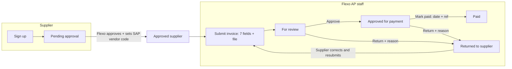

# Flexo Supplier Invoice Portal

Suppliers sign up, Flexo Accounting approves them, and then they submit invoices
online. Each submission is 7 required fields plus the invoice file. Flexo staff review
every invoice and approve it for payment, return it to the supplier with a reason, or
mark it paid. Suppliers can follow the status of each invoice in the portal.

| Piece | Where it runs |
|---|---|
| Web app (`public/`) | GitHub Pages (static hosting, deployed by GitHub Actions) |
| Accounts, database, file storage | Supabase (Auth + Postgres + Storage) |

`original/Flexo_Supplier_Invoice_Portal.html` is the first claude.ai prototype, kept for reference.

---

## How it works



### Invoice fields (all required)
1. Invoice number
2. Invoice date
3. PO number
4. VAT-exclusive amount
5. Total amount (the VAT is calculated and shown as Total − VAT-exclusive)
6. DR (delivery receipt) number
7. DR date

The invoice file (PDF, JPG or PNG, up to 10 MB) is also required.

The form also rejects these entries: a future date, a total lower than the VAT-exclusive
amount, and an invoice number the same supplier has already submitted (unless the earlier
one was returned).

There is **no automatic matching against SAP**. Staff check each invoice against the
attached file and SAP before approving. To help them, the invoice detail shows a warning
when the VAT isn't about 12%, when the same DR number appears on another invoice, or when
the invoice number was used before.

### Roles
| Role | Can do |
|---|---|
| Supplier (pending) | Sign in and see "awaiting approval". Cannot submit |
| Supplier (approved) | Submit invoices, and see **only their own** invoices and files |
| Staff | See all invoices; approve, return or mark paid; approve or reject supplier accounts and set their SAP vendor code; export CSV |
| Admin | Everything staff can do, and also make other accounts staff or admin |

These rules are enforced **by the database** (Supabase row-level security in
`supabase/schema.sql`), not just hidden in the screen. A supplier cannot read another
supplier's invoices or files, approve their own invoice, change an amount after
submitting, or make themselves staff. Every status change is written to a history log
that nobody can edit.

---

## Setup

### 1. Supabase database
1. In your Supabase project, open **SQL Editor**. Paste the whole of `supabase/schema.sql` and click **Run**.
   - If you used the earlier pilot version, this also locks its old open table (`docs`).
     Nothing is deleted. You can remove that table later with `drop table public.docs;`.
2. Go to **Authentication → Sign In / Providers → Email**:
   - Keep **Email** enabled.
   - **Turn OFF "Confirm email"** for now (see the email note below). Flexo's own approval step
     already confirms who each supplier is.
3. Go to **Authentication → URL Configuration**:
   - Set **Site URL** to `https://fmcai70.github.io/FlexoSupplier/`.
   - Add the same address under **Redirect URLs**.

### 2. Create the first admin
1. Open the portal and **Sign up** with your own Flexo email.
2. In the Supabase **SQL Editor**, run this with your own email:
   ```sql
   update public.profiles set role = 'admin', status = 'approved' where email = 'your.name@flexo.com.ph';
   ```
3. Sign out of the portal and sign in again. You'll see the **Invoices** and **Supplier accounts** tabs.

Other staff sign up the same way. An admin then sets their **Role** to `staff` and clicks **Approve**
under **Supplier accounts**.

### 3. Approve suppliers
Go to **Supplier accounts → Pending approval**. Check the company name, TIN and contact, then
type the supplier's **SAP vendor code** (CardCode) and click **Approve**. To refuse an account,
click **Reject** and give a reason, which the applicant will see.

### 4. GitHub Pages
This is already set up: the `SUPABASE_URL` and `SUPABASE_ANON_KEY` repository variables, Pages
source set to GitHub Actions, and the `github-pages` environment allowing `main`. Every push to
`main` redeploys the site.

### ✉️ Email (sign-up confirmation and password reset)
Supabase's built-in email only delivers to members of your Supabase team, so suppliers wouldn't
receive confirmation or "forgot password" emails. That's why "Confirm email" is off above. To turn
on password-reset emails for suppliers, add your own email sender under
**Authentication → Emails → SMTP Settings**. Your company Microsoft 365 mailbox, or a service such
as Brevo or Resend, will work. Until that is set up, password resets can't reach suppliers, so set up SMTP before inviting many suppliers.

### Local testing
```bash
cp public/config.example.js public/config.js   # fill in URL + anon key
npx http-server public -p 8080                 # open http://localhost:8080
```

---

## Files
| Path | What it is |
|---|---|
| `public/index.html`, `public/app.js`, `public/styles.css` | The portal |
| `supabase/schema.sql` | Tables, security rules, file storage, history log |
| `.github/workflows/deploy-pages.yml` | Publishes `public/` to GitHub Pages |
| `sap/*.sql` | SAP B1 export queries for POs and GRPOs. **Not used** by this version, which has no automatic matching. Kept for later |
